<div align="center">

<picture>
  <source media="(prefers-color-scheme: dark)" srcset="ressources/bandival_logo.svg">
  
</picture>

### Weniger Orga. Mehr Musik.

**Self-hosted Band-Management** – Songs, Lead Sheets, Noten, Setlists, Proben, Gigs, Touren und Bandkasse an einem Ort.<br>
Im Browser, als installierbare PWA und als native Android-App – mit einem Live-Modus, der auf der Bühne **synchron klickt, auch ohne Internet**.

[](https://github.com/F0uP/BANDival/actions/workflows/ci.yml)
[](https://github.com/F0uP/BANDival/actions/workflows/release-image.yml)
[](https://github.com/F0uP/BANDival/actions/workflows/android.yml)
[](LICENSE)
<br>


[**Schnellstart**](#-schnellstart-mit-docker) ·
[**Funktionen**](#-funktionen-im-überblick) ·
[**Android-App**](#-android-app) ·
[**Konfiguration**](#-konfiguration) ·
[**Entwicklung**](#-entwicklung) ·
[**Sicherheit**](#-sicherheit)

<br>

<picture>
  <source media="(prefers-color-scheme: dark)" srcset="docs/screenshots/hero-dark.webp">
  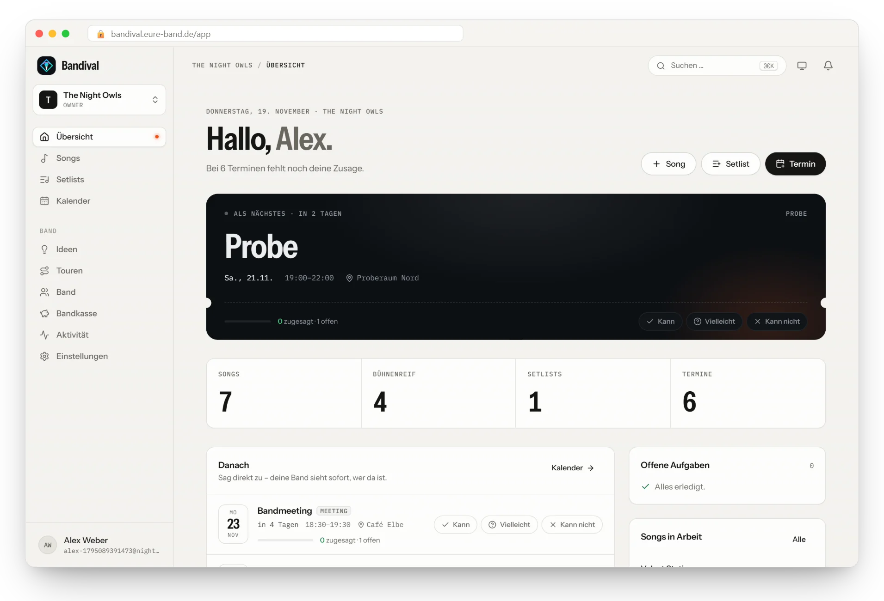
</picture>

</div>

## Warum Bandival?

- **Alles, wofür Bands sonst fünf Apps, drei Gruppenchats und eine Tabelle brauchen** – Repertoire, Proben, Gigs, Touren, Rechnungen und Kasse greifen ineinander: Die Setlist hängt am Gig, der Gig an der Tour, die Gage an der Rechnung und die Rechnung an der Bandkasse.
- **Gebaut für die Bühne** – Lead Sheets in großer Schrift, Click mit Einzähler, Fußpedal-Steuerung, und alle Handys laufen im selben Takt mit: per Bluetooth-Broadcast, ohne Kopplung, WLAN oder Internet.
- **Gemeinsam statt gegeneinander** – mehrere Leute können gleichzeitig am selben Song arbeiten, auch offline. Änderungen werden **wie bei Git zusammengeführt**; echte Konflikte entscheidest du selbst – nichts wird still überschrieben.
- **Eure Daten bleiben bei euch** – self-hosted mit Docker, ohne Tracking, Werbung oder Abo. KI ist optional und kann komplett lokal laufen.

> [!TIP]
> **Demnächst: Bandival Pulse** – ein Metronom zum *Fühlen* statt Hören. Ein kleines Gerät am Handgelenk oder Drum-Hocker vibriert im Takt, gesteuert aus dem Live-Modus, ohne Kopplung, WLAN oder Internet. Die Software ist fertig (Protokoll, App, Simulator); jedes Android-Handy kann schon heute als Pulse mitvibrieren. → [Spezifikation & Hardware-Vorschlag](docs/bandival-pulse.md)

## ✨ Funktionen im Überblick

<table>
  <tr>
    <td width="50%" valign="top">
      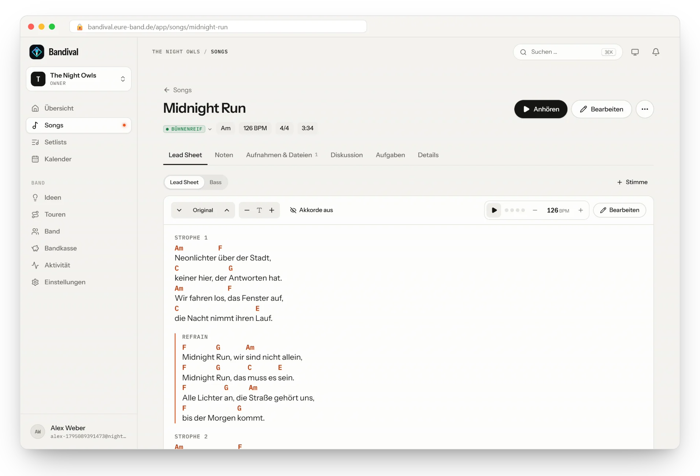
      <h3>🎼 Songs &amp; Lead Sheets</h3>
      ChordPro oder „Akkorde über Text“, mit einem Klick transponiert. Stimmen pro Instrument, Aufnahmen in <b>jedem Format</b> (Sprachmemos vom iPhone und Android, WAV, Videos …), <b>Tempo- und Tonart-Erkennung</b>, Click-Track-Export, Diskussionen und Aufgaben.
    </td>
    <td width="50%" valign="top">
      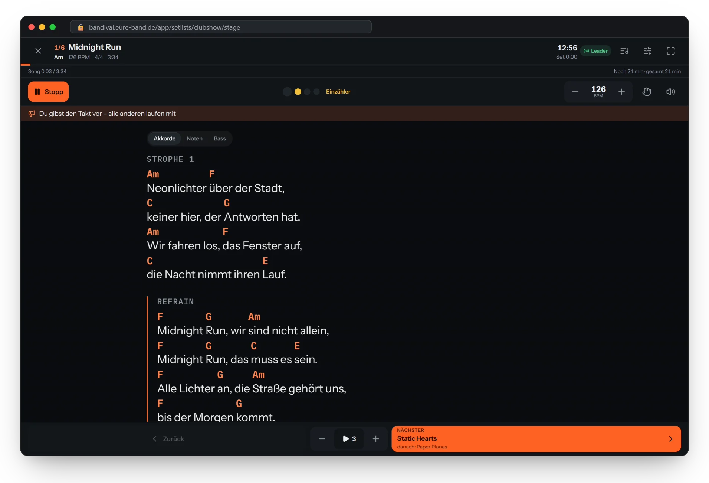
      <h3>🎛️ Live-Modus</h3>
      Großer Click mit Einzähler und Beat-Blitz, „Als nächstes“ mit Übergangsnotiz, Auto-Scroll und Fußpedal. <b>Bühnen-Sync</b>: Wer Start drückt, gibt den Takt vor – alle anderen Geräte laufen mit, auf Wunsch auch als Vibration.
    </td>
  </tr>
  <tr>
    <td width="50%" valign="top">
      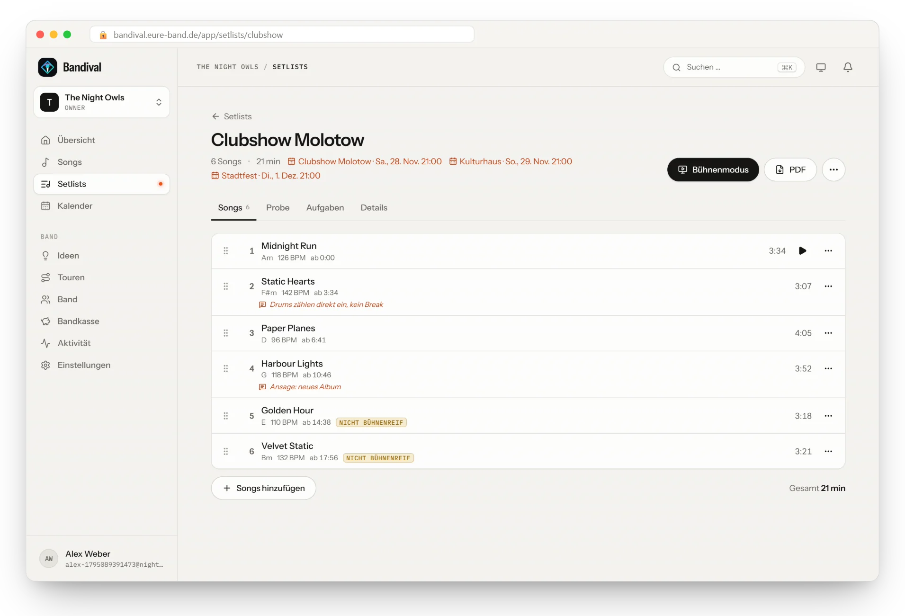
      <h3>📋 Setlists</h3>
      Drag &amp; Drop, laufende Startzeiten, Übergangsnotizen und „Passt gut danach“-Vorschläge. Offline vorgeladen, als PDF für die Bühne – und als <b>Click-Track fürs ganze Set</b>.
    </td>
    <td width="50%" valign="top">
      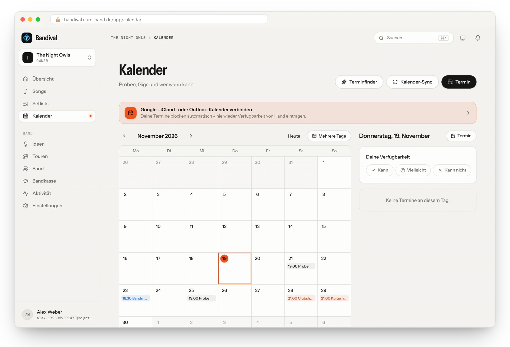
      <h3>📅 Kalender &amp; Terminfinder</h3>
      Proben, Gigs und Meetings mit Zu-/Absagen. Private Kalender (Google, iCloud, Outlook) blocken belegte Zeiten automatisch, der <b>Terminfinder</b> zeigt, wann alle können.
    </td>
  </tr>
  <tr>
    <td width="50%" valign="top">
      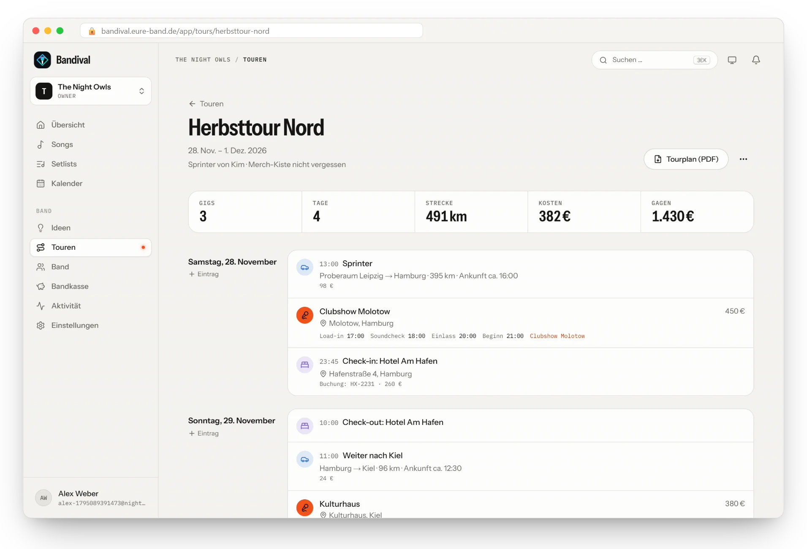
      <h3>🚐 Touren</h3>
      Gigs eines Zeitraums mit Fahrten, Unterkünften, Essen und Terminen – Tag für Tag. Strecke, Kosten und Gagen im Blick, <b>Tourplan als PDF</b> für die Crew.
    </td>
    <td width="50%" valign="top">
      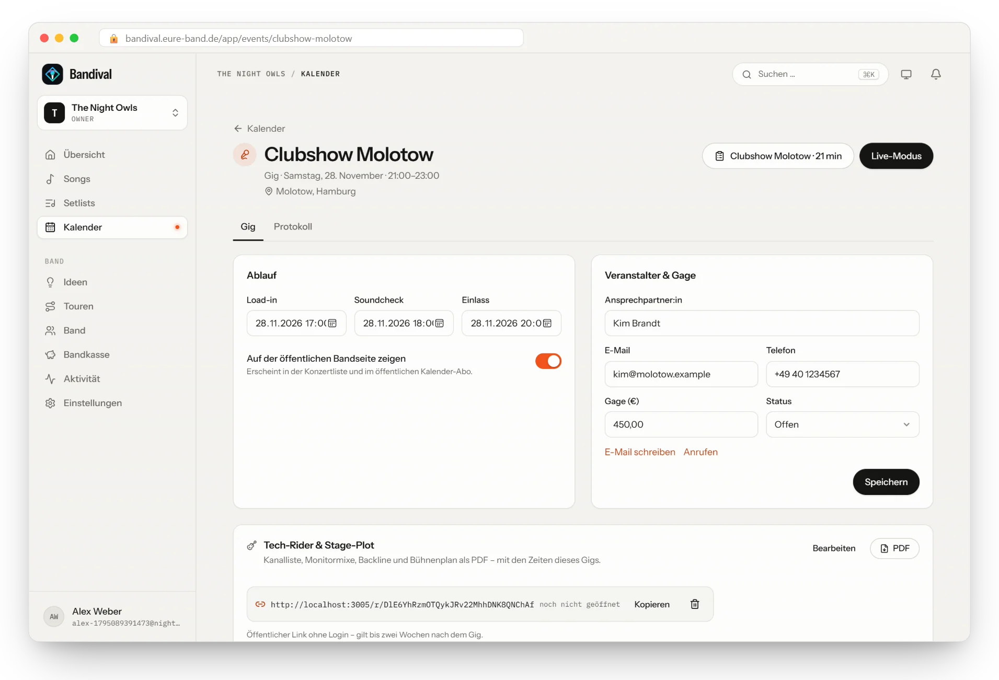
      <h3>🎤 Gigs, Rider &amp; GEMA</h3>
      Ablauf, Veranstalter und Gage, Tech-Rider mit Stage-Plot – als PDF oder als <b>Link für die Technik</b> ohne Login. Nach dem Gig die <b>GEMA-Musikfolge</b> als PDF/CSV.
    </td>
  </tr>
  <tr>
    <td width="50%" valign="top">
      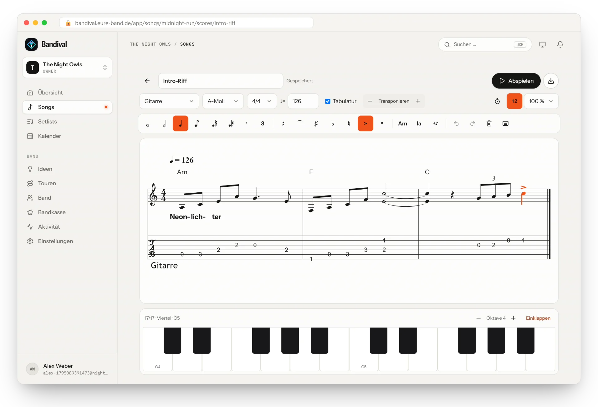
      <h3>🎹 Noteneditor</h3>
      Noten, Tabs und Drum-Grooves direkt im Browser: Tastatur-Eingabe wie in MuseScore, Klaviatur und Drum-Pads, Liedtext, Wiedergabe – Export als MusicXML, MIDI und PDF.
    </td>
    <td width="50%" valign="top">
      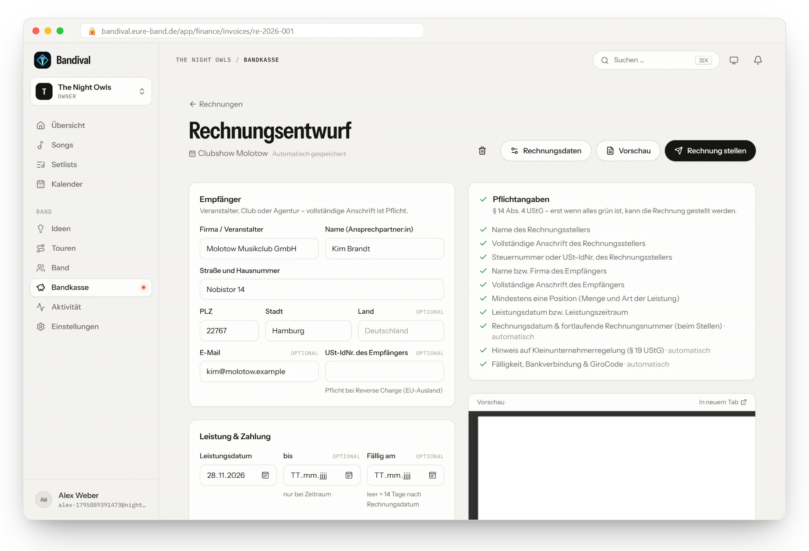
      <h3>🧾 Rechnungen &amp; Bandkasse</h3>
      Rechnungen mit allen Pflichtangaben nach § 14 UStG, fortlaufender Nummer und GiroCode – auf Deutsch oder Englisch. Bezahlte Gagen landen automatisch in der Bandkasse.
    </td>
  </tr>
  <tr>
    <td width="50%" valign="top">
      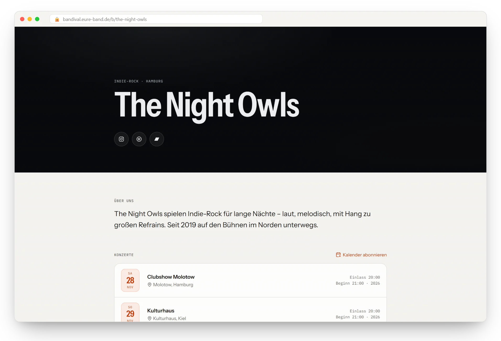
      <h3>🌐 Bandseite &amp; Pressekit</h3>
      Eure öffentliche Seite mit Bio, Konzerten (inkl. Kalender-Abo für Fans), Social-Links, Merch und Spotify-Player – ohne Login erreichbar.
    </td>
    <td width="50%" valign="top">
      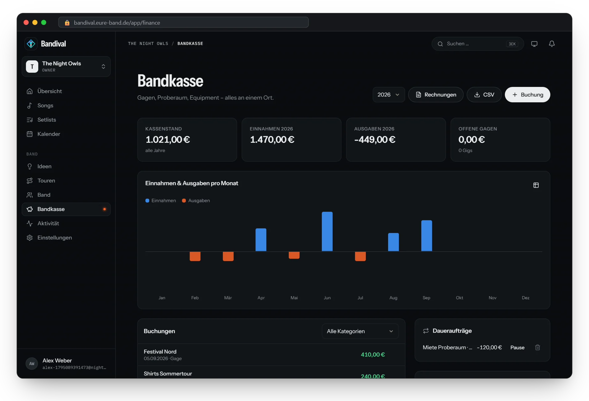
      <h3>🌙 Hell, Dunkel, Deutsch &amp; Englisch</h3>
      Durchdachtes Design in beiden Themes, Oberfläche auf Deutsch und Englisch – Benachrichtigungen kommen in der Sprache jeder Person.
    </td>
  </tr>
</table>

<div align="center">
  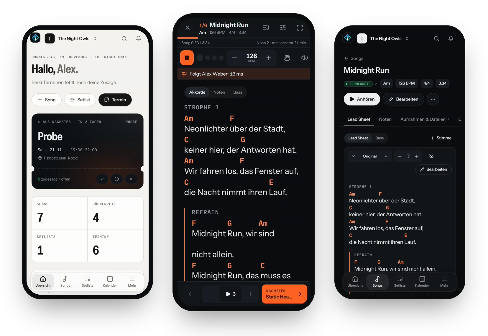
  <p><sub>Unterwegs als PWA oder native Android-App – rechts im Bild folgt ein zweites Gerät dem Click des Leaders (±3 ms).</sub></p>
</div>

<details>
<summary><b>Alle Funktionen im Detail</b></summary>

#### Songs
- Repertoire mit Status (Idee → In Arbeit → Bühnenreif → Archiv), Tonart, Tempo, Taktart, Dauer, Album
- **Lead Sheets** in ChordPro oder „Akkorde über Text“ – transponierbar, skalierbare Schrift, Akkorde ein/aus
- **Stimmen pro Instrument** (z. B. Bass-Tab, Drum-Pattern, Keys-Voicings) direkt neben dem Lead Sheet
- **Noteneditor** im Stil von MuseScore: Tastatur-Eingabe (A–G, Notenwerte 2–7, Punktierung, Triolen, Haltebögen), Bildschirm-Klavier und Drum-Pads, Akkordsymbole und Liedtext, Gitarren-/Bass-Tabulatur, Schlagzeugnotation, Transponieren, Wiedergabe mit Metronom/Einzähler, Export als MusicXML/MIDI/ABC/PDF, Import von MusicXML (z. B. aus MuseScore)
- Aufnahmen mit Versionsverlauf, globaler Player (läuft beim Navigieren weiter, Tempo, A/B-Loop)
- **Jedes Audioformat**: iPhone-/Android-Sprachmemos (M4A, CAF, AMR, 3GP, OPUS), WAV/FLAC/AIFF und Videos – der Server wandelt alles in MP3 um, das Original bleibt erhalten
- **Tempo & Tonart erkennen**: aus jeder Aufnahme geschätzt und im Song als Vorschlag angezeigt
- **Click-Track-Export** pro Song oder für ein ganzes Set (MP3, mit Einzähler) – fürs In-Ear-Zuspiel
- **Rechte & GEMA**: Komponist:innen, Texter:innen, Verlag und Werknummer je Song
- **Zeitmarken-Feedback**: Kommentare an einer Stelle der Aufnahme („bei 1:23 ist der Bass zu früh“) mit Wellenform
- **Übungsmixer** ohne KI: Gesang/Mitte, Stereo-Seiten, Bass & Höhen einer fertigen Aufnahme regeln (z. B. „ohne Gesang“, „ohne Bass“), Tempo mit gleicher Tonhöhe
- **Mehrspur (Stems)**: Einzelspuren hochladen und mit Mute/Solo/Lautstärke synchron üben
- **Import**: ChordPro-Dateien in Massen, Titellisten, Spotify-Playlists/Alben
- Noten & Dateien (PDF, MusicXML, Fotos), Diskussionen und Aufgaben pro Song, Alben mit Cover und Tracklist
- **Gleichzeitig bearbeiten**: Änderungen mehrerer Personen – auch offline – werden wie bei Git zusammengeführt; Konflikte löst ihr mit Vorschlägen selbst

#### Ideen-Inbox
- Riffs, Melodien und Textzeilen direkt im Browser oder in der App aufnehmen, anhören, kommentieren – und mit einem Klick zum Song machen

#### Setlists & Live-Modus
- Drag & Drop (Maus, Touch, Tastatur), laufende Startzeit je Song, Gesamtdauer
- Übergangsnotizen, „Passt gut danach“-Vorschläge (Tempo, Tonart, Bühnenreife)
- Besetzung & Packliste, Probenmodus mit Timer und Notizen je Song
- **Live-Modus**:
  - großer Click mit Taktart, Einzähler, Beat-Blitz und Tap-Tempo; startet auf Wunsch bei jedem Song automatisch im richtigen Tempo
  - „Als nächstes“ mit Übergangsnotiz, Setlist-Übersicht zum Springen, Uhr, Set- und Song-Timer
  - Akkorde, Text, Noten oder die eigene Stimme; Auto-Scroll und Transponieren
  - Bluetooth-Fußpedal: Songwechsel oder seitenweises Blättern (am Ende des Lead Sheets automatisch der nächste Song), Medientasten; Bildschirm bleibt an
- **Bühnen-Sync ohne Internet**: Wer Start drückt, gibt den Takt vor. Alle anderen Handys im Live-Modus laufen automatisch mit (Click/Vibration, Songwechsel):
  - in der Android-App per **Bluetooth-Broadcast**, ohne Kopplung, WLAN oder Server
  - im selben WLAN zusätzlich per UDP mit NTP-artigem Uhrenabgleich
  - im Browser über den Bandival-Server
  - Die Audio-Latenz jedes Geräts wird automatisch ausgeglichen.
- Ganze Setlists werden für offline vorgeladen; PDF-Export für die Bühne
- **Gäste/Aushilfen**: sehen nur freigegebene Setlists mit Lead Sheets, Noten und Aufnahmen

#### Kalender, Proben & Gigs
- Proben, Gigs, Meetings – inkl. Serien, Ort mit Kartenlink, verknüpfter Setlist, Status
- Zu-/Absagen pro Termin, Übersicht „Wer kann?“, Urlaub/Abwesenheit für mehrere Tage
- **Kalender-Sync**: Google-, iCloud- oder Outlook-Kalender per geheimer iCal-Adresse verbinden (oder `.ics` hochladen) – belegte Zeiten blocken automatisch. Andere sehen nur „belegt“, keine Details.
- **Band-Kalender abonnieren**: persönlicher Abo-Link für Google/Apple/Outlook
- **Terminfinder**: schlägt Tage vor, an denen die meisten können
- **Probe**: Protokoll mit Anwesenheit, gespielten Songs und Bewertung; **Probenplaner** schlägt vor, was geübt werden sollte (nächster Gig, holprige Songs, lange nicht gespielt, offene Aufgaben)
- **Gig**: Veranstalter, Gage & Zahlungsstatus, Load-in/Soundcheck/Einlass, **Tech-Rider mit Stage-Plot als PDF**
- **Link für die Technik**: Rider, Kanalliste, Monitormixe und Bühnenplan ohne Login unter `/r/<token>` – mit den Zeiten des Gigs, jederzeit zurückziehbar
- **GEMA-Musikfolge** nach dem Gig als PDF/CSV (aus Protokoll oder Setlist), mit Hinweis auf fehlende Rechte-Angaben
- **Touren**: Gigs eines Zeitraums mit Fahrten, Unterkünften, Essen und Terminen pro Tag, Strecke/Kosten/Gagen im Blick, Tourplan als PDF
- Erinnerungen 24 h vorher, Nachfrage bei fehlender Zusage, Wochenüberblick per Mail

#### Band, Finanzen & Verwaltung
- Mehrere Bands pro Person, Rollen (Owner/Admin/Mitglied/Gast), Einladungen per Mail oder Link
- **Bandkasse**: Einnahmen/Ausgaben, Daueraufträge (z. B. Proberaummiete), bezahlte Gagen werden automatisch gebucht, Gagen-Aufteilung, CSV-Export
- **Rechnungen** mit allen Pflichtangaben nach § 14 UStG, fortlaufender Nummer und GiroCode – wahlweise auf Deutsch oder Englisch
- **Öffentliche Bandseite / Pressekit** unter `/b/<name>`: Bio, Pressefoto, Konzerte (mit Kalender-Abo für Fans), freigegebene Songs zum Anhören, Social-Links, Merch-Shop, Spotify-Player, Booking-Kontakt
- Benachrichtigungen in der App, per **Web Push**, **ntfy** (auch ohne Google-Dienste) und E-Mail – pro Kategorie einstellbar und in der Sprache der jeweiligen Person
- Oberfläche auf **Deutsch und Englisch**; Impressum, Datenschutzerklärung, AGB und Cookie-Hinweis mit deutschen Vorlagen, von der Instanz-Administration bearbeitbar
- Anmeldung mit **Passkeys** (Fingerabdruck, Gesicht, Geräte-PIN), Passwort oder **Zwei-Faktor-Anmeldung** (TOTP + Wiederherstellungscodes); E-Mail-Bestätigung, Registrierungsmodus (offen / nur Einladung / geschlossen)
- **Automatische nächtliche Backups**, Backup & Restore, Aktivitätsverlauf, Hell/Dunkel-Modus, Befehlspalette (`⌘K` / `Strg+K`)

#### Optional: KI
Vom Server-Admin aktivierbar – ohne Konfiguration verlässt nichts den Server.
- **Spurtrennung** einer Aufnahme in Gesang, Drums, Bass und Rest mit dem selbst gehosteten Demucs-Dienst (kein Cloud-Dienst, siehe unten)
- mit OpenAI, Gemini oder lokal mit **Ollama**: „Akkorde über Text“ → ChordPro, Setlist-Dramaturgie vorschlagen, Band-Bio fürs Pressekit, Probenprotokolle zusammenfassen, Sprachmemos transkribieren (OpenAI/Gemini)

</details>

## 🚀 Schnellstart mit Docker

Voraussetzungen: Docker mit Compose-Plugin.

```bash
cp .env.example .env        # Werte anpassen – mindestens POSTGRES_PASSWORD und AUTH_SECRET
docker compose pull
docker compose up -d
```

Danach läuft Bandival auf `http://localhost:3000`. Beim ersten Registrieren wird automatisch deine Band angelegt – und dein Account wird Administrator der Instanz.

> [!IMPORTANT]
> `AUTH_SECRET` muss mindestens 32 zufällige Zeichen lang sein: `openssl rand -base64 48`. In Produktion immer HTTPS und `COOKIE_SECURE=true`.

Für einen Server ohne Git-Checkout gibt es ein schlankes Paket unter [`deploy/`](deploy/README.md). Das Docker-Image bringt **ffmpeg** mit – Aufnahmen werden damit automatisch konvertiert und analysiert.

## 🔧 Konfiguration

| Variable | Bedeutung |
| --- | --- |
| `POSTGRES_USER`, `POSTGRES_PASSWORD` | Datenbankzugang |
| `AUTH_SECRET` | Geheimer Schlüssel für Sitzungen, Einladungen und Kalender-Links (≥ 32 Zeichen) |
| `APP_BASE_URL` | Öffentliche URL, z. B. `https://bandival.meine-band.de` (für Links in Mails, Kalender-Abos und Rider-Links) |
| `COOKIE_SECURE` | `true`, sobald HTTPS genutzt wird (Pflicht in Produktion) |
| `SMTP_*` | Optional: Mailversand für Einladungen, Bestätigungen und Benachrichtigungen |
| `REGISTRATION_MODE` | `open` (Default), `invite` (nur mit Einladung) oder `closed` – der allererste Account geht immer |
| `INSTANCE_ADMIN_EMAILS` | Admins der Instanz (kommagetrennt) – pflegen Impressum, Datenschutzerklärung, AGB und Cookie-Hinweis unter *Einstellungen → Rechtliches*. Leer = der zuerst registrierte Account |

<details>
<summary><b>Alle Variablen</b></summary>

| Variable | Bedeutung |
| --- | --- |
| `APP_TIMEZONE` | Standard-Zeitzone neuer Bands (Default `Europe/Berlin`) |
| `CALENDAR_SYNC_ALLOW_PRIVATE` | `true` erlaubt Kalender-Import aus dem LAN (z. B. Nextcloud im selben Netz) |
| `VAPID_PUBLIC_KEY`, `VAPID_PRIVATE_KEY` | Optional: feste Web-Push-Schlüssel (sonst automatisch erzeugt und gespeichert) |
| `BACKUP_ENABLED`, `BACKUP_RETENTION_DAYS` | Nächtliche JSON-Backups pro Band ins Volume `bandival_backups_data` (Default: an, 14 Tage) |
| `AI_PROVIDER`, `AI_MODEL`, `AI_API_KEY`, `AI_BASE_URL` | Optional: `openai`, `gemini` oder `ollama` für KI-Funktionen |
| `STEM_SEPARATION_URL`, `STEM_SEPARATION_TOKEN` | Optional: selbst gehostete Spurtrennung (Compose-Profil `ai`) |
| `SPOTIFY_CLIENT_ID`, `SPOTIFY_CLIENT_SECRET` | Optional: Spotify-Playlists als Songs importieren |
| `TRUSTED_PROXY_COUNT` | Anzahl Reverse-Proxys vor Bandival (Default `1`, `0` ohne Proxy) – für das Login-Rate-Limit |
| `EMAIL_VERIFICATION` | `required` (Default), `optional` oder `off` – greift nur, wenn SMTP eingerichtet ist |
| `PASSWORD_BREACH_CHECK` | `true` (Default): Passwörter aus bekannten Datenlecks ablehnen (k-Anonymität), `false` für Offline-Instanzen |
| `LANDING_PAGE` | `false` blendet die Startseite aus – `/` führt dann direkt zum Login |
| `FFMPEG_PATH`, `FFPROBE_PATH` | Optional: Pfade zu ffmpeg/ffprobe (im Docker-Image enthalten). Damit werden Aufnahmen in jedem Format – M4A, CAF, AMR, 3GP, OPUS, WAV, FLAC, Videos … – im Hintergrund zu MP3 umgewandelt; ohne ffmpeg werden Dateien unverändert gespeichert |
| `ANDROID_CERT_SHA256` | Fingerabdruck des APK-Signaturzertifikats – aktiviert Passkeys in der Android-App (`/.well-known/assetlinks.json`) |

</details>

### Optional: KI-Funktionen

```bash
# Spurtrennung (Demucs, läuft komplett auf eurem Server – CPU reicht, ein paar Minuten pro Song)
docker compose --profile ai up -d
#   .env: STEM_SEPARATION_URL=http://stem-splitter:8000  und ein STEM_SEPARATION_TOKEN

# Lokales Sprachmodell statt Cloud
docker compose --profile ollama up -d && docker exec bandival-ollama ollama pull llama3.1
#   .env: AI_PROVIDER=ollama  AI_BASE_URL=http://ollama:11434  AI_MODEL=llama3.1
```

Mit `AI_PROVIDER=openai` bzw. `gemini` (+ `AI_API_KEY`) gehen die jeweiligen Texte an den Anbieter. Die App weist darauf hin. Audio-Spurtrennung läuft immer nur lokal.

### Updates

```bash
docker compose pull web && docker compose up -d
```

Beim Start führt der Container die Datenbank-Migrationen automatisch aus. **Bestehende Installationen**, deren Datenbank früher per `prisma db push` angelegt wurde, werden dabei erkannt und automatisch übernommen (Baseline) – Daten bleiben erhalten:

- Tagesverfügbarkeiten werden in die neue persönliche Verfügbarkeit überführt,
- Instrumente/Equipment von Setlists und der Song-Status werden aus den alten Text-Feldern übernommen.

Vor größeren Updates empfiehlt sich ein Backup (Einstellungen → Backup) bzw. ein Dump des Volumes `bandival_db_data`.

### Daten

| Volume | Inhalt |
| --- | --- |
| `bandival_db_data` | PostgreSQL |
| `bandival_uploads_data` | Aufnahmen (MP3 + Original), Noten, Cover, Avatare, Ideen, Pressefotos |
| `bandival_backups_data` | Nächtliche JSON-Backups (Download unter Einstellungen → Backup) |

## 📱 Android-App

Die **native App** (Kotlin, Jetpack Compose, Material 3) verbindet sich mit eurer Instanz. Download als APK unter [Releases](https://github.com/F0uP/BANDival/releases).

| | |
| --- | --- |
| **Live-Modus** | Sample-genaues Metronom, Vibration im Takt, Bühnen-Funk per Bluetooth ohne Internet, Bandival Pulse, Bluetooth-Seitenwender (Songwechsel oder Blättern) |
| **Proben-Alltag** | Übersicht mit Zusagen, Kalender, Songs mit transponierbaren Lead Sheets, Setlists |
| **Aufnahmen & Ideen** | Wiedergabe im Hintergrund mit Sperrbildschirm-Steuerung, Ideen per Sprachmemo aufnehmen |
| **Sicher & offline** | Passkeys und biometrische App-Sperre, Anmeldung für Wochen gemerkt, Offline-Cache, Benachrichtigungen |
| **Desktop-Werkzeuge** | Noteneditor, Bandkasse und Einstellungen laufen eingebettet mit derselben Anmeldung |

Details, Signierung und Build: [`android/README.md`](android/README.md). Alternativ lässt sich Bandival auf jedem Gerät als **PWA** installieren („Zum Startbildschirm hinzufügen“).

## 📆 Kalender-Sync einrichten

1. **Kalender → Kalender-Sync → Meine Termine blocken**
2. Anbieter wählen und der Anleitung folgen (bei Google: *Einstellungen → Kalender → „Privatadresse im iCal-Format“*)
3. Link einfügen – fertig. Die Kalender werden alle 30 Minuten (beim Öffnen des Kalenders) aktualisiert.

Für das Abo der Band-Termine (Tab **Band-Termine abonnieren**) muss der Server aus dem Internet erreichbar sein, da Google/Apple den Link selbst abrufen.

## 🧰 Entwicklung

Voraussetzungen: Node.js 22, PostgreSQL 16, optional ffmpeg (Audio-Konvertierung, Tempo-/Tonart-Erkennung, Click-Tracks).

```bash
cd web
npm ci
cp ../.env.example .env.local   # DATABASE_URL, AUTH_SECRET setzen
npm run db:migrate              # Migrationen anwenden
npm run dev
```

| Befehl | Zweck |
| --- | --- |
| `npm run lint` / `npm run typecheck` | Statische Prüfungen |
| `npm run build` | Produktions-Build |
| `npm run test:e2e` | API- und Browser-Tests gegen einen laufenden Server (`E2E_BASE_URL`, optional `E2E_BROWSER_CHANNEL=msedge`) |
| `npx prisma migrate dev --name …` | Neue Migration nach Schema-Änderung |

### Architektur

- **Next.js 16** (App Router, React 19), Tailwind CSS 4, SWR, lucide-Icons, eigenes Design-System mit Hell/Dunkel-Tokens
- **Prisma 7** (Driver Adapter `@prisma/adapter-pg`) + PostgreSQL 16, Zod-Validierung, einheitliche Fehlerbehandlung (`src/lib/http.ts`)
- **Git-artiges Zusammenführen** (`src/lib/merge`): 3-Wege-Merge für Texte (Lead Sheets, Stimmen), Felder, Listen und Noten; Offline-Änderungen werden beim Synchronisieren gemergt
- **i18n**: deutscher Quelltext als Schlüssel, englischer Katalog in `src/i18n/en.json`, Sprache pro Konto für Push und Mails
- Auth: Passkeys (WebAuthn), Session-Cookies (HttpOnly, gleitend) + CSRF-Double-Submit im Proxy (`src/proxy.ts`), Rate-Limiting
- Rechte zentral in `src/lib/permissions.ts` (Server und Client)
- Audio-Pipeline (`src/lib/audio.ts`): ffprobe-Prüfung, Hintergrund-Konvertierung nach MP3, Tempo-/Tonart-Schätzung (Onset-Autokorrelation, Krumhansl-Profile)
- PDFs (Rechnungen, Rider, Setlists, Tourplan, GEMA-Musikfolge) mit `pdf-lib`; Uploads mit Range-Support, Auslieferung nur an Bandmitglieder
- Kalender-Import mit `ical.js` (Serien, Ausnahmen, Zeitzonen), SSRF-geschützter Abruf

### CI/CD

| Workflow | Auslöser | Inhalt |
| --- | --- | --- |
| `ci.yml` | Push/PR | Lint, Typecheck, Migrationen (frisch, idempotent, Upgrade einer Alt-DB, Drift-Check), Build, E2E gegen PostgreSQL (inkl. ffmpeg und Browser) |
| `release-image.yml` | Push auf `main`, Tags `v*` | Docker-Images nach GHCR: `bandival-web` und `bandival-stem-splitter` (`latest`, `x.y.z`, `sha-…`) |
| `android.yml` | Änderungen in `android/`, Tags `v*` | Unit-Tests, Lint, APK/AAB bauen (AGP 9, Gradle 9), bei Tags GitHub-Release mit signierter APK |

Release erstellen: `git tag v2.0.0 && git push origin v2.0.0`

## 🔒 Sicherheit

Kurzfassung (Details und Meldeweg für Lücken: [SECURITY.md](SECURITY.md)):

- Immer HTTPS + `COOKIE_SECURE=true` in Produktion, `AUTH_SECRET` mit mindestens 32 zufälligen Zeichen (`openssl rand -base64 48`)
- `.env` niemals committen (ist in `.gitignore`) – wurde sie je committet, alle Secrets darin austauschen
- Anmeldung: Passkeys (WebAuthn, phishing-resistent), Passwörter nach NIST 800-63B inkl. Datenleck-Prüfung, TOTP-2FA mit Replay-Schutz und verschlüsseltem Secret, gleitende Sessions (30 Tage Inaktivität)
- Strenge Content-Security-Policy mit Nonce pro Anfrage, HSTS, CSRF-Schutz (Double Submit), SSRF-Schutz für Kalender-Import und ntfy
- Git-artiges Zusammenführen paralleler Änderungen – nichts wird still überschrieben
- Hochgeladene Dateien werden nur an Bandmitglieder ausgeliefert, mit `nosniff`; SVG-Uploads sind gesperrt; öffentliche Rider-Links sind zufällige 192-Bit-Tokens und jederzeit widerrufbar

## 📄 Lizenz

AGPL-3.0 – siehe [LICENSE](LICENSE).

<div align="center">
<sub>Gemacht für Bands, die lieber proben als planen.</sub>
</div>
